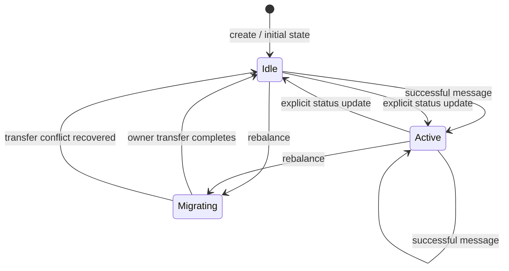
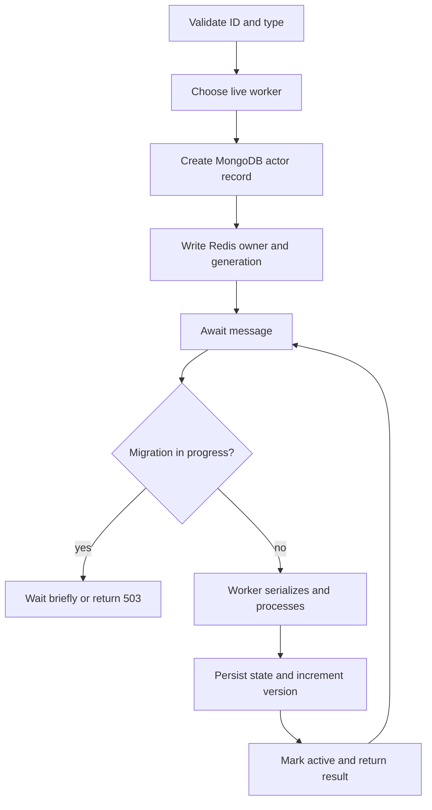

# Actor lifecycle

## Lifecycle stages

1. **Create:** API validates the actor ID/type, selects the least-loaded live
   worker by assigned actor count, creates a MongoDB record, and records the
   owner/generation in Redis.
2. **Idle record:** the new document has `status: idle`; no worker-local actor
   object is instantiated.
3. **Message execution:** API resolves the worker and generation; worker queues
   and processes the message, persists a new state/version, and marks status
   `active`.
4. **Status update:** API/page can set status to `active` or `idle`. This is a
   stored display/lifecycle flag; `idle` does not stop future messages.
5. **Migration:** eligible actor is marked `migrating`; after drain/transfer
   it is marked `idle` at the new owner/generation.
6. **Recovery:** the next ownership resolution can reassign an actor whose
   worker is no longer live. State is reloaded from MongoDB.

See [actor_lifecycle.mmd](diagrams/actor_lifecycle.mmd). The displayed
`active`/`idle` status should not be confused with a runtime-managed
passivation/activation protocol: execution is document-per-message, and
`migrating` is the only status that causes the routing path to wait/reject.

## Failure and recovery boundaries

After a worker has committed an actor update to MongoDB, another worker can
reload the persisted state. The API does not automatically retry every
unreachable worker request or preserve it in a queue. When it resolves ownership
again, it can choose a live worker and increment the assignment generation.
Rebalancing can also move assignments after stale worker registrations are
pruned.

## Diagram

Related: [Message processing](MESSAGE_PROCESSING.md),
[state management](STATE_MANAGEMENT.md), and
[rebalancing](DYNAMIC_REBALANCING.md).
