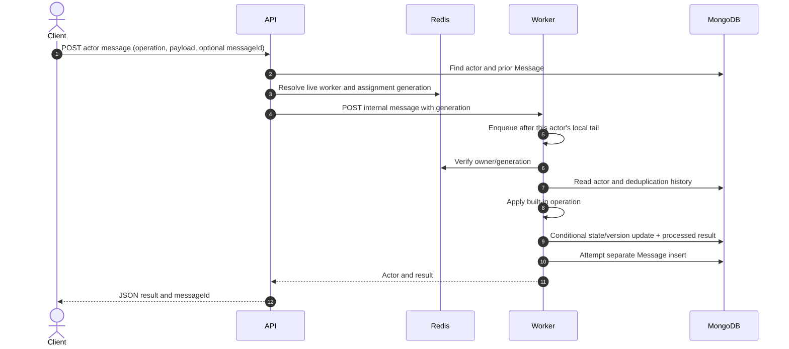

# Message processing

## Request contract

The public endpoint is `POST /api/actors/:id/messages`. Its JSON body requires
a string `operation` of at most 80 characters. `payload`, when present, must be
a non-array object. `messageId` is optional and, when supplied, must be a
string no longer than 120 characters. The API generates a UUID if omitted.

Supported operations and payloads are actor-type specific; see
[Actor model](ACTOR_MODEL.md) and the [API reference](API_REFERENCE.md).

## Pipeline

1. The API validates the request and reads the MongoDB actor record.
2. It waits briefly if the actor is marked `migrating`; otherwise it checks for
   an already logged message with that ID.
3. `ensureActorOwner` resolves a live worker, current Redis assignment, and
   generation. A singleton actor also requires an active lease.
4. The API sends an HTTP POST to the selected worker with message ID and
   ownership generation. The request has a configurable timeout.
5. The worker serializes work by actor ID within its process.
6. The worker checks Redis ownership/generation, checks the message log and
   recent processed-message cache, checks MongoDB assignment, and (for the
   scheduler) validates the singleton lease generation.
7. Built-in actor logic computes the next state/result.
8. MongoDB conditionally updates state, version, status, last-active timestamp,
   and a rolling set of the most recent 256 message IDs/results.
9. The worker attempts a separate `Message` document insert, updates worker
   counts best-effort, then returns the result to the API.

## Sequence diagram

The standalone diagram is [message_flow.mmd](diagrams/message_flow.mmd).

## Ordering, retries, and guarantees

- **Ordering:** a worker queue preserves arrival order for requests queued for
  the same actor on that worker. There is no global ordering across processes.
- **Retry:** the API returns `503` for an unreachable worker or timeout; it
  does not enqueue a retry. A caller may retry with the same `messageId`.
- **Deduplication:** recent message IDs/results are held in the actor document
  (last 256) and message IDs are unique in the Message collection. A retry can
  return a prior result. The bounded cache and separate writes leave failure
  windows.
- **Commit order:** state and processed ID are saved first; the message log is
  inserted afterward. If the latter write fails, state remains committed and a
  warning is logged. It is not a transaction.
- **Guarantee:** do not call this exactly-once. It is synchronous,
  best-effort duplicate suppression with a durable state update and bounded
  deduplication history.

## Failures

Invalid operation/payload and actor-specific rule failures return `400`; an
insufficient balance returns `409`. Stale owner/version conflicts return
`409`. An unknown actor returns `404`. No worker, unreachable worker, or
prolonged migration returns `503`; coordinator/worker request timeouts can
also surface as an error. The common API error middleware returns
`{ "error": "..." }`.

Related: [State management](STATE_MANAGEMENT.md),
[Worker management](WORKER_MANAGEMENT.md), and
[Limitations](LIMITATIONS_AND_FUTURE_SCOPE.md).
