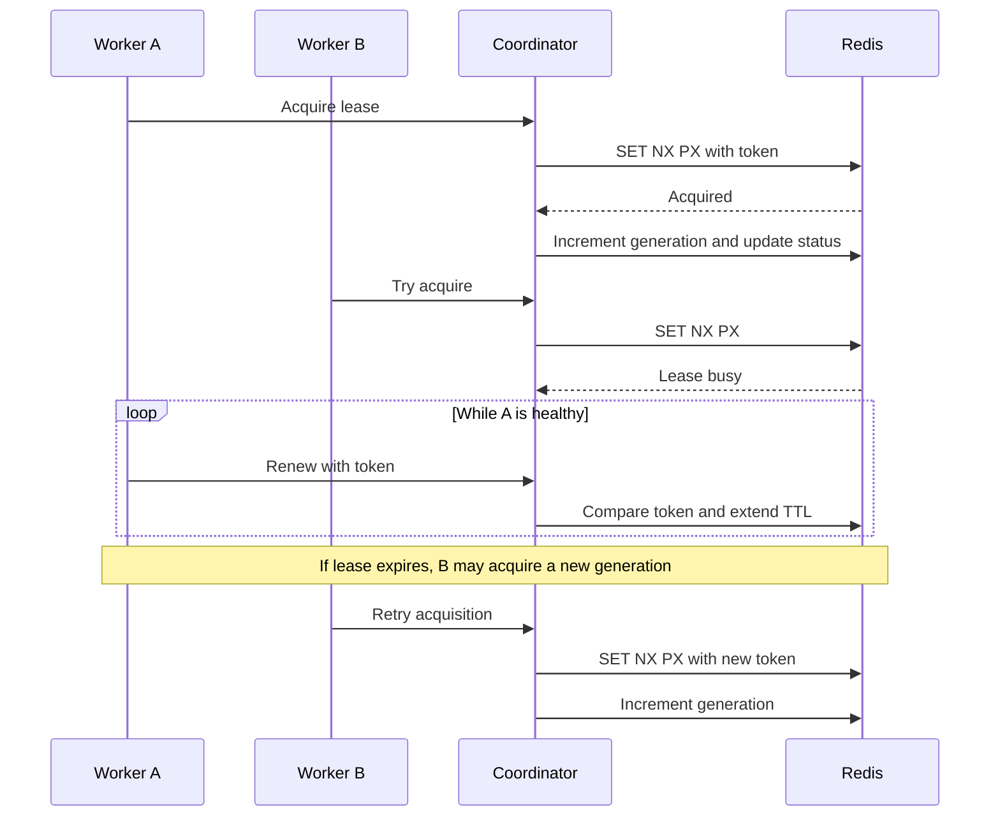

# Singleton actors

## Purpose and scope

ActorLab includes `GlobalSchedulerActor` as a demonstration of one active
worker owner for a shared logical actor. The actor has ordinary MongoDB state
(`jobs` and `ticks`), but message routing additionally requires the worker
holding the Redis singleton lease.

## Lease protocol

1. Each worker's heartbeat task tries to acquire a lease if it has no local
   lease, otherwise it tries to renew it.
2. Acquisition uses Redis `SET` with `NX` and `PX`, with the configured TTL
   (default 12 seconds), and a random token.
3. A successful acquisition increments
   `actorlab:singleton:generation` and writes the holder/token/generation/expiry
   fields to `actorlab:singleton:status`.
4. Renewal uses a Lua script that extends TTL only if the stored JSON exactly
   matches the worker ID and token supplied by the lease holder.
5. When the current lease expires, another worker can acquire a new token and
   higher generation.
6. Before executing a scheduler message, the worker checks the lease key's
   worker ID and the status hash generation against the request's singleton
   generation.
7. On graceful shutdown, a worker deletes the lease key only if the stored
   value still matches its worker ID and token.

The flow is shown in [singleton_failover.mmd](diagrams/singleton_failover.mmd).

## Fencing and limits

The singleton generation is distinct from an actor's owner generation.
Messages carry both as needed; worker execution rejects a scheduler message
whose lease owner or generation does not match Redis. The lease key is
token-checked, but the status hash update and lease operations are not one
atomic transaction. This is a demonstration protocol, not a claim of
fault-tolerant singleton semantics under Redis failover or multiple
coordinator inconsistencies.

Lease renewal is attempted on the worker heartbeat interval. If renewal fails,
the worker's local lease becomes null and it attempts acquisition on a later
heartbeat. The singleton dashboard reports lease status; the page's
`/singletons/register` action creates the built-in actor record. It does not
itself guarantee that a lease is currently held.

## Built-in operations

`tick` increments `ticks`; `addJob` appends a generated ID, supplied/default
name, and timestamp; `get` returns jobs and ticks. `GlobalSchedulerActor` is
excluded from the ordinary rebalancer.

See [Database design](DATABASE_DESIGN.md) and
[Testing and validation](TESTING_AND_VALIDATION.md).
