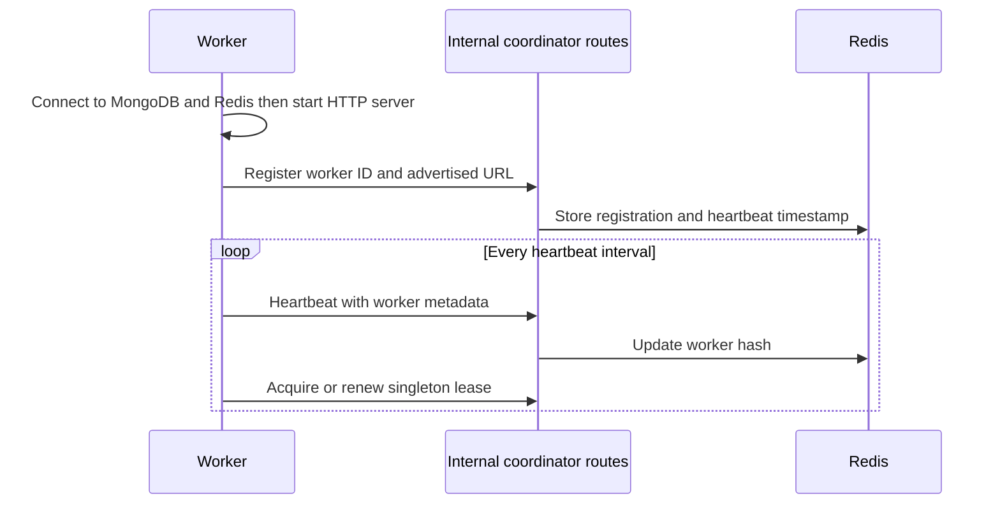

# Worker management

## Worker startup and registration

A worker is started with `node src/server.js --worker` (`npm run worker`).
It connects to MongoDB and Redis, listens on `WORKER_PORT` (default 3101), and
registers with the coordinator at `COORDINATOR_URL` (default
`http://localhost:3000`). Its URL is built from `WORKER_ADVERTISE_HOST`,
`POD_IP`, or a pod DNS name fallback.

After startup, a periodic task (default 4 seconds) reads the worker's local
health endpoint and posts its ID, URL, local queue-map size, host, and runtime
mode to `/internal/workers/heartbeat`. The health value is not a count of all
MongoDB actors assigned to the worker. If the coordinator reports that the
registration expired, it re-registers. Worker discovery and heartbeat behavior
are shown in [worker_registration.mmd](diagrams/worker_registration.mmd).

The Redis registry stores JSON in hash `actorlab:workers`. `listWorkers`
filters heartbeat timestamps against a 15-second default timeout and deletes
expired or invalid records when called. There is no separate liveness
controller.

## Placement and routing

When an actor is created, the runtime chooses a live worker with the fewest
actor documents assigned to it. Later messages use the Redis owner map and
MongoDB assignment, repairing ownership if the current owner is no longer
live. The worker validates the assignment generation before executing.

## Process-local mailbox

Each worker holds a map of per-actor promise tails. It chains operations for
one actor so that those requests run sequentially within that process. The
queue is volatile and does not coordinate across worker processes. A drain
endpoint waits for the current tail when a rebalancer moves an actor.

## Failure and shutdown

API requests to an unreachable worker fail with `503`; there is no durable
queue. A worker's expired registration is pruned when the coordinator lists
workers. Ownership can be reassigned during a later routing decision, or the
manual rebalancer can move actors from workers no longer listed as live.

On SIGTERM/SIGINT, worker stops its heartbeat timer, waits for tracked tails,
closes its HTTP server, compare-and-deletes its current singleton lease if
still held, quits Redis, and exits.

Kubernetes can restart a failed pod and adjust worker replica count, but actor
registration, routing, and manual migration are application behaviors. See
[Kubernetes integration](KUBERNETES_INTEGRATION.md).
